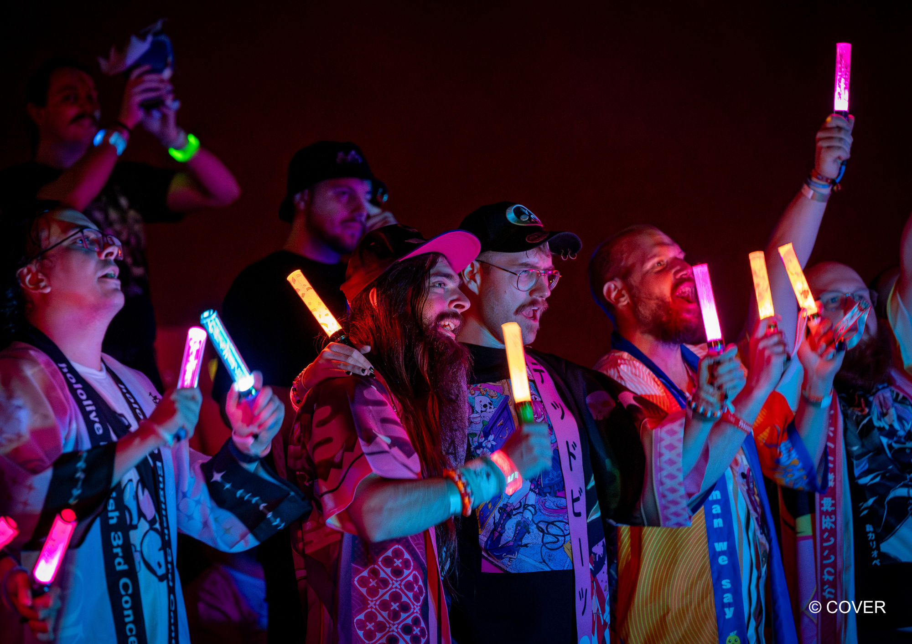

Cheering, cosplay and a cinema full of penlights: hololive's latest European screening tour encouraged fans to treat a trip to the pictures like a concert.

The six-city run of **hololive English 4th Concert -Serendipity-** finished at Colosseum Berlin on 18 October 2026, after opening at Cineworld Birmingham NEC on 17 September. Between those dates, it visited Milan, Barcelona, Paris and Düsseldorf.

British company Virtual Stage Productions licensed and staged the tour, bringing recordings of hololive's Los Angeles concert to European audiences. Fans watched both nights in one sitting, on a single ticket.

<!--more-->

## Two nights in Los Angeles, one European cinema trip

For anyone new to hololive, its talents are human entertainers who perform through animated avatars. Their activities include livestreaming and music, with concerts bringing those characters onto a shared stage.

Serendipity originally took place at the Shrine Auditorium in Los Angeles on 3 and 4 July. The concert featured all fifteen members of hololive English, alongside guests Ookami Mio, Tsunomaki Watame, Vestia Zeta and Kobo Kanaeru.

There were different setlists across the two nights and seven specially formed performing units. Among the collaborations was Bloodraven, pairing Nerissa Ravencroft and Elizabeth Rose Bloodflame for "Cruel Angel's Thesis" from *Neon Genesis Evangelion*. The concert also introduced the first live performance of its title track, "Serendipity".

The European screenings brought that programme into rooms where fans were encouraged to join in. Cosplay was welcome, and audiences could bring penlights up to 20cm long.

Speaking to [Japan Nakama](https://www.japannakama.co.uk/creativity/music/hololive-vtuber-concerts-interview/), Virtual Stage Productions founder Steve Lei explained:

> "We run our shows as chant-friendly events, reflecting the atmosphere audiences would experience in Japan."

His team has also supported fan call books and chant guides, helping newcomers learn when and how to join the crowd.

## Birmingham's hololive weekend

The Birmingham screening opened a weekend of hololive appearances beside the NEC.

The following day, nine talents took part in VeXpo 2026, billed by organisers as hololive production's first appearance at a British convention. They included all four members of hololive Justice: Elizabeth Rose Bloodflame, Gigi Murin, Cecilia Immergreen and Raora Panthera.

These appearances were separate from the recorded Serendipity screening. The talents performed remotely from Japan, with their avatars transmitted to the convention's Monarch Stage. Programming included a Justice panel and a karaoke relay, while Hakos Baelz also performed live in 3D during Saturday night's premium concert.

## More chances to watch together

Serendipity followed Virtual Stage Productions' European screenings of the previous hololive English concert, *All for One*, earlier this year.

Lei told Japan Nakama that the company is developing production tools with the ambition of producing more VTuber experiences locally. The interview offers something for UK fans to watch for, although it does not announce dates for a follow-up tour.

For now, this run has finished. You can explore the performances in [hololive's official Serendipity concert report](https://hololive.hololivepro.com/en/events/serendipity/), or read [Japan Nakama's full interview](https://www.japannakama.co.uk/creativity/music/hololive-vtuber-concerts-interview/) about bringing the shows to Europe.

## Image credit

<figure style="margin:0">
  
  <figcaption>Fans in happi coats at the <em>All for One</em> screening at Colosseum Berlin in May 2026, from hololive's earlier European tour. This is not a photograph of Serendipity or VeXpo. Photo: H.E-X Studios © COVER.</figcaption>
</figure>

Photograph supplied for press coverage by Japan Nakama in the [tour press kit](https://drive.google.com/drive/folders/1uIGj60nOI1GMiRuSuYt7fJTE4fKXQ9ZR). Used unchanged, with the original copyright mark retained.
