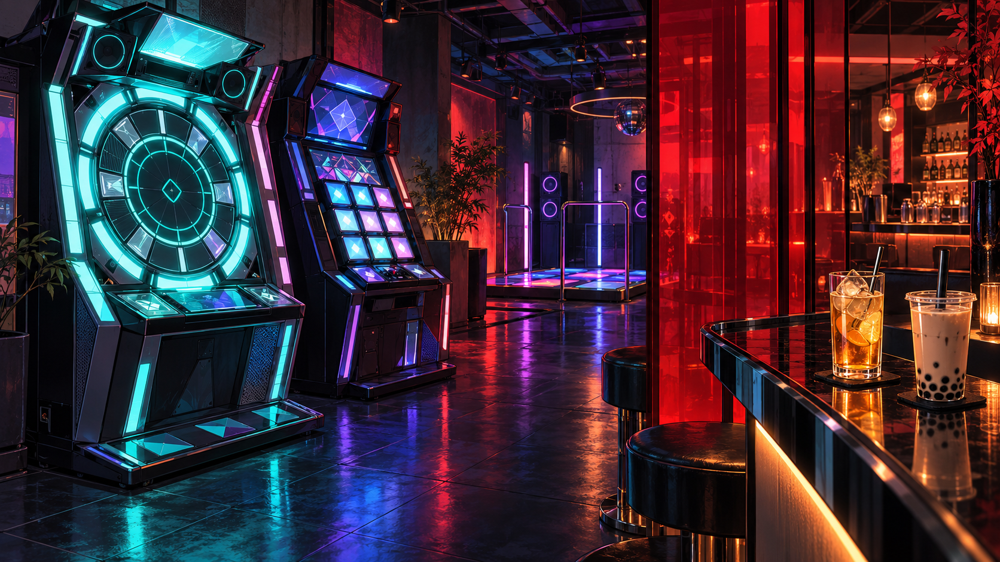

<figure style="margin:0 0 24px">
  
  <figcaption>AI-generated illustration inspired by Japanese rhythm-arcade and bar culture. It does not depict NQJPN or its actual interior.</figcaption>
</figure>

maimai, jubeat, WACCA and DANCERUSH are heading into a new late-night home on Berwick Street. NQJPN, the Japanese-inspired arcade bar from the team behind NQ64, is scheduled to open in Soho on **Friday 23 October 2026**.

The venue takes over NQ64's former Berwick Street premises, following that bar's move to Manette Street. It brings a different line-up of games and drinks to the old address, with imported Japanese arcade cabinets, alcoholic bubble teas and a convenience-store-inspired counter called NQ Mart.

## A line-up worth checking before your next London trip

The rhythm games are a good reason to pay attention.

NQJPN's published arcade list includes **maimai, jubeat, WACCA and DANCERUSH**, alongside Japanese DDR, Groove Coaster and Music Gun Gun. Driving-game fans can also look out for an Initial D7 twin cabinet, while Bishi Bashi and Panic Park appear on the list too.

For anyone whose arcade experience stops at a joystick and a few buttons, this is a chance to try something different. maimai puts a circular touchscreen and a ring of buttons in front of you; jubeat asks you to follow musical patterns across a grid of illuminated panels. DANCERUSH gets your feet involved on a large dance platform.

The venue also advertises free-play consoles. That wording applies to the consoles, so don't assume every imported cabinet is free to play.

## Cocktails at the front, an arcade behind the curtain

The space is split between a late-night bar and a dedicated arcade, separated by a translucent red curtain.

The drinks menu includes a Melon Cucumber Daiquiri, Chilli Pepper Margarita and Sesame Cookie Old Fashioned. There's also a Tequila Apple Yuzu Bubble Tea, alongside alcohol-free options.

Inside the arcade, NQ Mart takes its cue from Japanese convenience stores. Launch coverage describes a build-your-own drinks counter where customers choose a spirit, soft drink and syrup or foam, plus a self-serve ramen station.

DJs are planned for Friday and Saturday nights. This is a bar-and-nightlife opening with an arcade attached, rather than a daytime family gaming centre.

## Entry and arcade prices

[Japan Nakama's opening guide](https://www.japannakama.co.uk/gaming/nqjpn-soho/) lists **free entry and arcade credits starting at £10**. NQJPN also advertises free-play consoles, separate from its imported arcade cabinets.

The £10 figure is a starting price for arcade credits, not a confirmed unlimited-play deal. Check with the venue for current game and drinks prices before your visit.

## Planning a visit

NQJPN's own website lists the address as **53 Berwick Street, Soho, London, W1F 8SP**.

Its advertised regular hours are:

- **Monday to Friday:** 3pm to 3am
- **Saturday:** midday to 3am
- **Sunday:** midday to midnight

The venue advertises walk-ins seven days a week, with enquiries available for groups of 20 or more.

For opening updates and visitor information, check the [official NQJPN website](https://nqjpn.co.uk/) before travelling.

## Further reading

- [NQJPN's official website and game/drink lists](https://nqjpn.co.uk/)
- [The Spirits Business launch report](https://www.thespiritsbusiness.com/2026/10/nq64-to-open-japan-themed-bar-in-soho/)
- [Japan Nakama's opening preview](https://www.japannakama.co.uk/gaming/nqjpn-soho/)
